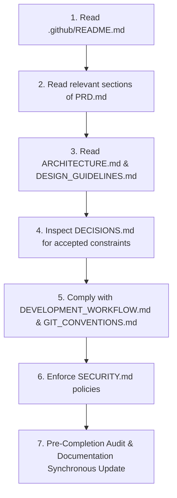

# Futurefina Consultancy — WhatsApp Bot & CRM Engineering Documentation

Welcome to the central documentation repository for **Futurefina Consultancy** (AMFI ARN: 179325, Founder: Kaushik Raval). This directory acts as the definitive single source of truth (SSOT) for product requirements, architecture, design standards, development workflows, Git conventions, security policies, and architectural decision records.

---

## 1. Project Overview

**Futurefina WhatsApp Bot & CRM** is a compliant, multilingual financial services customer assistant and lead management platform operating across **6 core service lines**:
1. **Mutual Funds** (SIP, Lumpsum, KYC assistance, statutory risk disclosures)
2. **Stocks & Demat Services** (Demat account opening via partner links, general education)
3. **Insurance** (Health, Term Life, Traditional Life, Motor, Commercial, Personal Accident, Workmen Compensation)
4. **Loans** (Loan against Mutual Funds / LAMF, Personal Loans)
5. **ITR & Tax Filing** (Salary, Capital Gains/Stocks/IPO, High-volume trading; indicative fees: ₹1,200 / ₹1,500 / ₹2,000+)
6. **Existing Customer Support** (Renewals, claims, policy documents, escalations)

### Key Architectural Pillars:
- **Dual-Engine Conversation System**: Combines a *Deterministic Flow Engine* (guaranteeing zero-hallucination lead capture, statutory disclaimers, and consent verification) with a *Grounded LLM* (for natural language multilingual intent detection and FAQ answering bounded to the verified knowledge base).
- **Multilingual Support**: Seamless tri-lingual communication in **Gujarati (ગુજરાતી), Hindi (हिंदी), and English**.
- **Human Handover Protocol**: Instant context-rich handover to founder Kaushik Raval or designated advisory team members.
- **Approved Obsidian-Mint UI**: High-density advisor CRM dashboard utilizing calibrated dark slate surfaces (`#212227`, `#2A2D34`), electric mint accents (`#13AD87`), and high-contrast white action pills (`#FFFFFF`).

---

## 2. Documentation Directory Structure

All engineering documentation is strictly maintained within the `.github/` tree. Root-level files are limited to workspace configuration; `.opencode/` contains project-scoped agent instructions, not product documentation. No root-level README or workflow automation files exist outside these locations.

```text
.github/
├── README.md                           # Documentation Master Index (this file)
└── docs/
    ├── PRD.md                          # Product Requirements Document
    ├── ARCHITECTURE.md                 # System Architecture & Technical Specifications
    ├── DESIGN_GUIDELINES.md            # UI/UX Standards, Design Tokens & Ergonomics
    ├── DEVELOPMENT_WORKFLOW.md         # Environment Setup, Local Dev & Testing Protocols
    ├── GIT_CONVENTIONS.md              # Conventional Commits & AI Safety Boundary
    ├── CONTRIBUTING.md                 # Code Quality Standards & Pull Request Lifecycle
    ├── SECURITY.md                     # Secrets, Webhook Security & Data Privacy
    └── DECISIONS.md                    # Chronological Architecture Decision Records (ADR)
```

### 2.1 Implementation Workspace

```text
apps/
└── web/                                # Next.js 16 advisor console (Phases 1–4)
    ├── src/app/                        # App Router: /, /inbox, /leads, /settings
    ├── src/components/                 # layout, dashboard, leads, shadcn primitives
    ├── src/lib/                        # formatters, typed fixtures, service colours
    └── e2e/                            # Playwright journeys and axe scans
packages/
└── shared/                             # domain types, statuses, categories, labels
```

Phase 1 delivers the Overview dashboard against typed fixtures. The API and PostgreSQL layers are added in Phase 5 per [DEC-010](docs/DECISIONS.md#dec-010-monorepo-workspace-layout-and-mock-first-ui-delivery).

---

## 3. Documentation Matrix & File Responsibilities

| File Path | Document Name | Target Audience | Core Purpose |
| :--- | :--- | :--- | :--- |
| [`.github/README.md`](README.md) | **Documentation Index** | All Developers & Agents | Central directory index, navigation map, and maintenance rules. |
| [`docs/PRD.md`](docs/PRD.md) | **Product Requirements** | Product, Engineers, QA | Defines product vision, personas, scope, functional/non-functional requirements. |
| [`docs/ARCHITECTURE.md`](docs/ARCHITECTURE.md) | **System Architecture** | Architects, Backend/Frontend Devs | System topology, component boundaries, database schemas, and data pipelines. |
| [`docs/DESIGN_GUIDELINES.md`](docs/DESIGN_GUIDELINES.md) | **UI/UX Guidelines** | Frontend Engineers, UI/UX | Design philosophy, color tokens, typography, layouts, and accessibility standards. |
| [`docs/DEVELOPMENT_WORKFLOW.md`](docs/DEVELOPMENT_WORKFLOW.md) | **Development Workflow** | Developers, DevOps | Local setup, environment config, testing, debugging, and deployment practices. |
| [`docs/GIT_CONVENTIONS.md`](docs/GIT_CONVENTIONS.md) | **Git Conventions** | Developers, AI Agents | Conventional Commits, branch naming, PR rules, and mandatory AI safety governance. |
| [`docs/CONTRIBUTING.md`](docs/CONTRIBUTING.md) | **Contribution Standards** | Contributors, Reviewers | Code quality gates, naming conventions, review checklists, and PR standards. |
| [`docs/SECURITY.md`](docs/SECURITY.md) | **Security Standards** | Security, Engineers, Admins | Credential isolation, Meta webhook HMAC validation, RBAC, and data privacy. |
| [`docs/DECISIONS.md`](docs/DECISIONS.md) | **Decision Log (ADR)** | All Team Members | Immutable chronological log of architectural and engineering decisions (DEC-XXX). |

---

## 4. Recommended Reading Order

### A. New Developer Onboarding
To quickly build mental context and contribute effectively:
1. **[`README.md`](README.md)** (Start here for structure and conventions)
2. **[`docs/PRD.md`](docs/PRD.md)** (Understand what we are building and why)
3. **[`docs/ARCHITECTURE.md`](docs/ARCHITECTURE.md)** (Understand how the services and data fit together)
4. **[`docs/DEVELOPMENT_WORKFLOW.md`](docs/DEVELOPMENT_WORKFLOW.md)** (Set up your local machine and verify the build)
5. **[`docs/GIT_CONVENTIONS.md`](docs/GIT_CONVENTIONS.md)** & **[`docs/CONTRIBUTING.md`](docs/CONTRIBUTING.md)** (Learn commit formats and review expectations)
6. **[`docs/SECURITY.md`](docs/SECURITY.md)** (Review credential handling and webhook safety rules)

### B. AI Coding Agent Protocol
Before undertaking any implementation task, autonomous coding agents **MUST** execute the following sequence:



#### Protocol Rules:
1. **Never Invent Client Requirements**: If a requirement or constraint is ambiguous, mark it `[PENDING CONFIRMATION]` or consult the user.
2. **Consult Decision History**: Verify that proposed changes do not violate existing `Accepted` decisions in [`docs/DECISIONS.md`](docs/DECISIONS.md).
3. **Strict Git Permission Boundary**:
   - AI agents must **NEVER** automatically execute `git commit` or `git push`.
   - Editing files in the working directory does not grant permission to commit.
   - Separate, explicit user approval is mandatory for both committing and pushing.
   - Always summarize changes and present diffs before asking for commit authorization.
4. **Documentation Synchronization**: Before completing any implementation task:
   - Identify any stale or contradicting documentation.
   - Synchronously update the relevant docs (`PRD.md`, `ARCHITECTURE.md`, `DECISIONS.md`).
   - Never silently change accepted requirements or architecture.

---

## 5. Documentation Maintenance Rules

1. **Single Source of Truth**: All architectural and product decisions must reside in this directory. Do not maintain competing specs in external wikis or ephemeral chat threads.
2. **Markdown Compatibility**: All documentation must be clean, valid GitHub-Flavored Markdown (GFM). Use standard code blocks, alerts (`> [!NOTE]`, `> [!IMPORTANT]`, etc.), and Mermaid diagrams.
3. **Relative Linking**: All cross-references must use relative markdown links (e.g., `docs/PRD.md` or `../README.md`). Never use machine-specific absolute paths.
4. **Status Transparency**: Every feature, architectural choice, or schema proposal must carry an explicit status tag:
   - `[CONFIRMED]`: Verified project fact or requirement.
   - `[ASSUMPTION]`: Working assumption subject to verification.
   - `[PROPOSED]`: Design or technical proposal awaiting review.
   - `[PENDING CONFIRMATION]`: Blocked on client or stakeholder input.
5. **No Ephemeral Drift**: When code changes modify database schemas, API contracts, or UI token systems, the respective documentation files must be updated in the same pull request.
