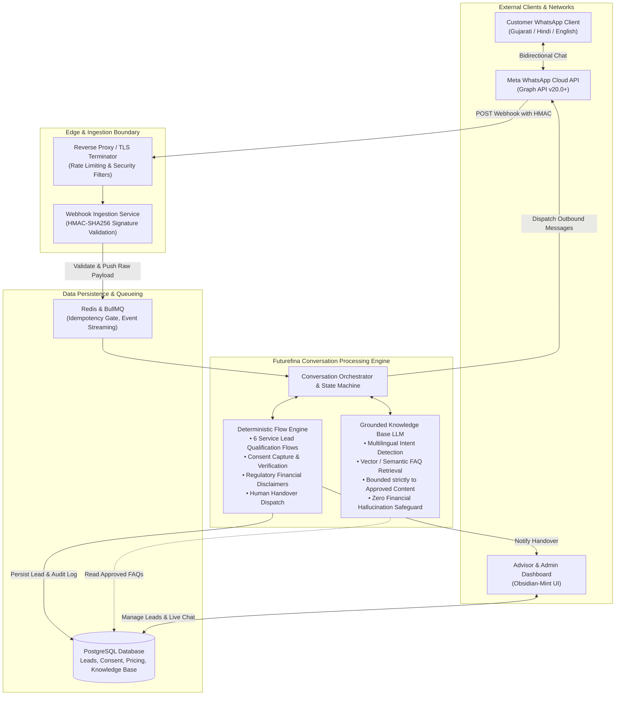
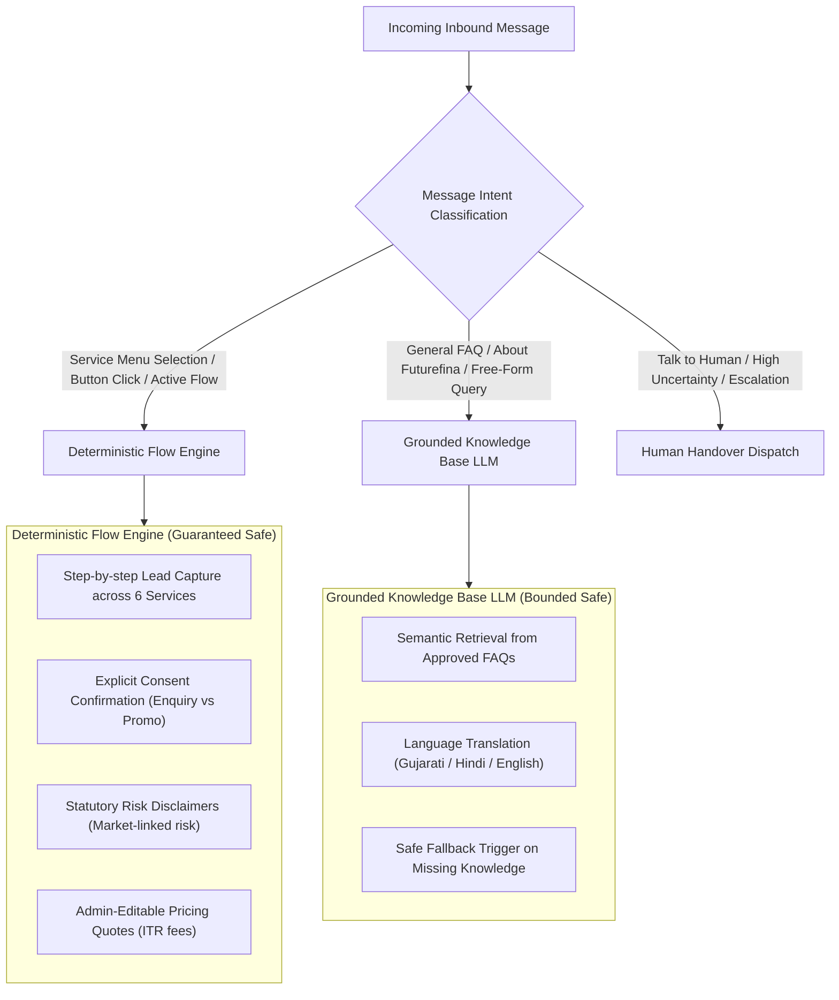
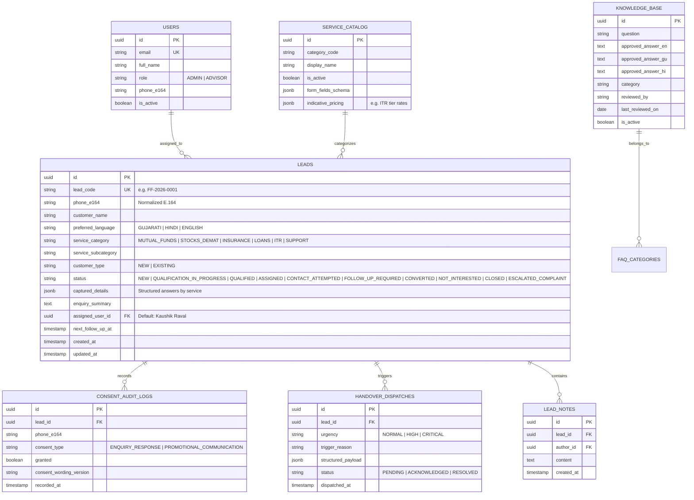
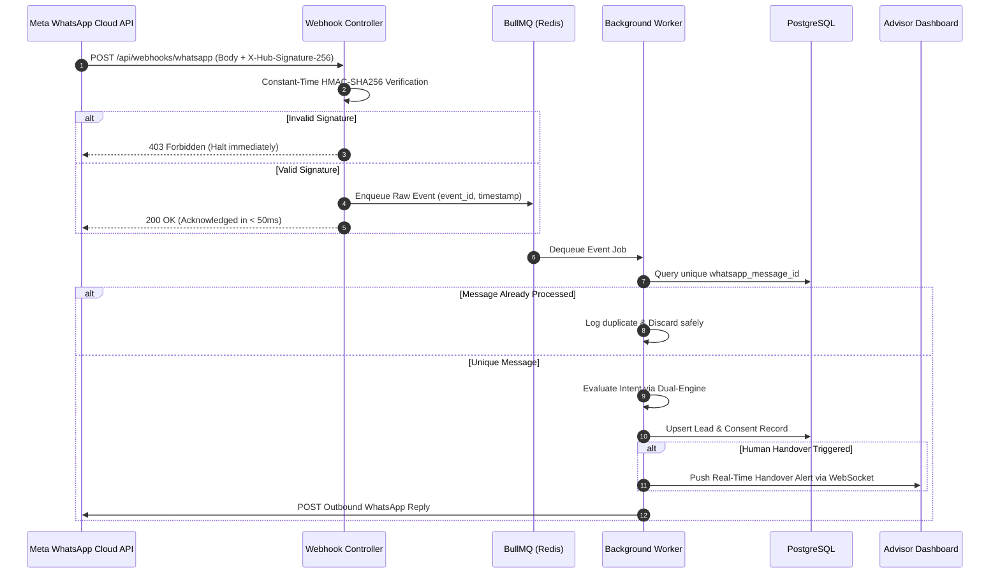
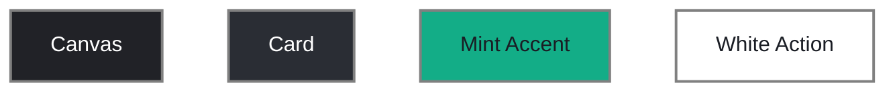

# System Architecture & Technical Specifications

> **Document Status**: Approved Baseline Architecture  
> **Parent Navigation**: [Documentation Index](../README.md) | [PRD](PRD.md) | [Design Guidelines](DESIGN_GUIDELINES.md) | [Security](SECURITY.md) | [Decisions](DECISIONS.md)

---

## 1. Architectural Overview & System Topology

The **Futurefina WhatsApp Bot & CRM** platform is architected as an event-driven, decoupled system combining a high-throughput webhook ingestion layer, a **Dual-Engine Conversation System** (Deterministic Flow Engine + Grounded Knowledge Base LLM), a durable background job processor, and an administrative CRM dashboard.

---

## 2. The Dual-Engine Conversation Architecture

In accordance with [DEC-007](DECISIONS.md#dec-007-dual-engine-conversation-architecture-deterministic-flow--grounded-llm) and strict financial services regulatory standards (AMFI ARN: 179325), conversational processing is strictly partitioned into two specialized engines:

### 2.1 Deterministic Flow Engine
- **Role**: Executes all critical qualification funnels, legal disclaimers, data collection steps, and consent checkpoints.
- **Guarantee**: Operates strictly via deterministic finite state machines (FSM). Zero chance of hallucinating interest rates, promising guaranteed returns, or asking for unauthorized data.

### 2.2 Grounded Knowledge Base LLM
- **Role**: Understands user intent in natural language (handling mixed Gujarati-English, Hinglish, or colloquial phrasing) and provides factual answers derived exclusively from the verified Futurefina knowledge base.
- **Strict Boundary**: If the knowledge base does not contain an approved answer for a specific query, the LLM is prohibited from generating an answer and must trigger the safe fallback to a human advisor.

---

## 3. Futurefina Database Schema & Entity Relationships

The relational schema is specifically modeled for Futurefina's lead lifecycle, 6 service lines, 10 official lead statuses, and consent auditing:

---

## 4. Webhook Ingestion & Anti-Duplicate Pipeline

Meta delivers webhooks on an *at-least-once* basis. Retried payloads or network hiccups frequently deliver duplicate events.

---

## 5. Technology Stack & Operational Infrastructure

| Layer | Technology | Role in Futurefina Platform |
| :--- | :--- | :--- |
| **Frontend Dashboard** | **Next.js (React 19, TypeScript)** | High-density admin console utilizing the **Obsidian-Mint** design system. |
| **Styling & Theme** | **Tailwind CSS + shadcn/ui** | Custom tokens for `#212227` canvas, `#2A2D34` cards, and `#13AD87` mint accents. |
| **Backend & Routing** | **Node.js (TypeScript) / Express** | Webhook endpoint, state machine routing, WebSocket hub. |
| **Primary Database** | **PostgreSQL (v15+)** | ACID transactions for lead records, consent logs, and service catalogs. |
| **Queue & Cache** | **Redis + BullMQ** | Decoupled webhook processing, rate limiting, and scheduled follow-up tasks. |
| **Knowledge Base** | **PostgreSQL pgvector / Embeddings** | Semantic similarity search for approved FAQ answering. |
| **External Messaging** | **Meta WhatsApp Cloud API (v20.0+)** | Official WhatsApp Business messaging gateway. |

**Obsidian-Mint palette reference** — exact tokens and semantic roles are maintained in [Design Guidelines §2](DESIGN_GUIDELINES.md#2-color-system--design-tokens-obsidian-mint-palette). The `#808080` swatch frame is documentation-only and is not a product token:

---

## 6. Scalability & Operational Resilience

1. **Webhook Spikes**: BullMQ absorbs broadcast response bursts, ensuring the HTTP listener maintains < 50ms response times.
2. **Sub-5-Second Guarantee**: Deterministic state machine responses are calculated and queued in < 200ms; LLM retrieval is cached for repeated queries.
3. **Dead Letter Queue (DLQ)**: Failed message dispatches or database write errors are quarantined in a DLQ with automated alerting to system administrators.
4. **Data Isolation**: Multi-tenant/multi-session query partitioning ensures zero cross-talk between separate customer phone sessions.
