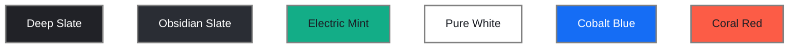

# Architecture & Engineering Decision Records (ADR)

> **Document Status**: Living Engineering Decision Log  
> **Parent Navigation**: [Documentation Index](../README.md) | [PRD](PRD.md) | [Architecture](ARCHITECTURE.md) | [Development Workflow](DEVELOPMENT_WORKFLOW.md) | [Git Conventions](GIT_CONVENTIONS.md)

---

## Decision Log Governance Rules

1. **Sequential Identification**: Every entry receives a permanent, sequential identifier formatted as `DEC-XXX` (e.g., `DEC-001`, `DEC-002`).
2. **Explicit Approval Gate**: All newly drafted technical choices begin with status `Proposed`. A decision may only transition to `Accepted` after explicit, documented review and approval by human project leadership.
3. **No Historical Erasure**: Never delete or erase an existing decision entry. If a previously accepted decision is abandoned or revised, mark its status as `Superseded` or `Deprecated` and cross-reference the replacement `DEC-XXX`.
4. **Mandatory 7-Section Format**: Every decision record must strictly adhere to the standardized schema defined below.

---

## Decision Record Index

| ID | Title | Date | Status | Category |
| :--- | :--- | :--- | :--- | :--- |
| [DEC-001](#dec-001-centralized-documentation-system-structure-in-github) | Centralized Documentation System Structure in `.github/` | 2026-11-09 | Proposed | Architecture |
| [DEC-002](#dec-002-conventional-commits--ai-git-governance-policy) | Conventional Commits & AI Agent Git Governance Policy | 2026-11-09 | Proposed | Development |
| [DEC-003](#dec-003-core-architecture--technology-stack-selection-criteria) | Core Architecture & Technology Stack Selection Criteria | 2026-11-09 | Proposed | Technology |
| [DEC-004](#dec-004-asynchronous-webhook-ingestion--idempotent-processing-model) | Asynchronous Webhook Ingestion & Idempotent Processing Model | 2026-11-09 | Proposed | Architecture |
| [DEC-005](#dec-005-direct-meta-whatsapp-cloud-api-integration-approach) | Direct Meta WhatsApp Cloud API Integration Approach | 2026-11-09 | Proposed | Integration |
| [DEC-006](#dec-006-adoption-of-obsidian-mint-ui-color-system-and-token-architecture) | Adoption of Obsidian-Mint UI Color System and Token Architecture | 2026-11-09 | Accepted | UI-UX |
| [DEC-007](#dec-007-dual-engine-conversation-architecture-deterministic-flow--grounded-llm) | Dual-Engine Conversation Architecture (Deterministic Flow + Grounded LLM) | 2026-11-09 | Accepted | Architecture |
| [DEC-008](#dec-008-multilingual-tri-language-strategy-gujarati-hindi-english) | Multilingual Tri-Language Strategy (Gujarati, Hindi, English) | 2026-11-09 | Accepted | Product |
| [DEC-009](#dec-009-strict-financial-compliance-data-minimization--prohibited-credentials) | Strict Financial Compliance, Data Minimization & Prohibited Credentials | 2026-11-09 | Accepted | Security |

---

## DEC-001: Centralized Documentation System Structure in `.github/`

- **Date**: 2026-11-09
- **Status**: Proposed
- **Category**: Architecture

### 1. Context
A clean, durable, and maintainable engineering documentation foundation is needed for the WhatsApp CRM project. The documentation must serve as an authoritative single source of truth (SSOT) for both human engineers and autonomous AI coding agents without cluttering the repository root or interfering with production builds.

### 2. Problem
Without a structured documentation hierarchy, development standards, architectural schemas, and PRD specifications become scattered, fragmented, or lost in code comments. Furthermore, root-level documentation can create merge conflicts with application build configurations.

### 3. Decision
Organize the entire repository documentation under a single dedicated `.github/` directory:
- Entry point: `.github/README.md`
- Detailed specifications: `.github/docs/*.md`
- Exclude root-level README files, YAML workflow automations, and unapproved markdown documents.

### 4. Alternatives Considered
- *Root-Level Documentation Folder (`/docs`)*: Pollutes repository root alongside source directories (`/src`, `/public`).
- *Wiki / External Notion*: Disconnects code changes from documentation changes, leading to inevitable documentation drift.

### 5. Reasoning
The `.github/` folder is natively recognized by GitHub, keeps the project root clean, and allows documentation to be versioned atomically alongside application code in pull requests.

### 6. Consequences
- **Positive**: Clear navigation hierarchy, atomic PR documentation updates, clean project root.
- **Negative / Trade-offs**: Developers accustomed to finding a root `README.md` must be guided to `.github/README.md`.

### 7. Related References
- [Documentation Index](../README.md)
- [PRD](PRD.md)
- [Contributing Guidelines](CONTRIBUTING.md)

---

## DEC-002: Conventional Commits & AI Git Governance Policy

- **Date**: 2026-11-09
- **Status**: Proposed
- **Category**: Development

### 1. Context
The development workflow involves human engineers collaborating closely with autonomous AI coding agents. Automated Git actions by AI agents risk polluting Git history, causing unintended branch modifications, or committing untested changes.

### 2. Problem
How do we ensure that Git history remains clean, bisectable, and standardized, while preventing AI agents from executing unauthorized commits or destructive pushes?

### 3. Decision
1. Standardize on the **Conventional Commits 1.0.0** specification (`<type>(<scope>): <description>`).
2. Establish a strict, non-negotiable **AI Git Safety Boundary**:
   - AI agents must never automatically commit or push.
   - Working tree modifications do not imply authorization to commit.
   - Committing does not authorize pushing.
   - Explicit user approval is required separately for both actions.
   - Destruction of Git history (force pushes, history rewrites) is strictly banned.

### 4. Alternatives Considered
- *Permissive Agent Autonomy*: Allowing AI agents to commit and push on feature branches autonomously. Rejected due to the risk of runaway commits and unverified changes entering remote branches.
- *Unstructured Commits*: Allowing arbitrary commit messages. Rejected due to difficulty in automated changelog generation and history readability.

### 5. Reasoning
A strict permission gate protects the integrity of the codebase and ensures that human developers remain in total control of the Git timeline.

### 6. Consequences
- **Positive**: Total user control, clean and parseable Git history, zero risk of runaway automated pushes.
- **Negative / Trade-offs**: Requires explicit user intervention before changes are finalized in Git.

### 7. Related References
- [Git Conventions](GIT_CONVENTIONS.md)
- [Contributing Guidelines](CONTRIBUTING.md)

---

## DEC-003: Core Architecture & Technology Stack Selection Criteria

- **Date**: 2026-11-09
- **Status**: Proposed
- **Category**: Technology

### 1. Context
The WhatsApp CRM requires a high-performance web frontend for conversational messaging, a real-time reactive inbox, high-throughput webhook handling, and ACID-compliant transaction tracking for deals and contacts.

### 2. Problem
We must establish an initial technical baseline for the frontend, backend, database, and queuing layers without prematurely locking in unconfirmed client preferences.

### 3. Decision
Propose a modern, type-safe full-stack TypeScript ecosystem marked as `[PROPOSED - PENDING CONFIRMATION]`:
- **Frontend**: Next.js (React 19, TypeScript, Tailwind CSS, shadcn/ui).
- **Backend**: Node.js (TypeScript) API with WebSocket / SSE support.
- **Database**: PostgreSQL (v15+) with Prisma or Drizzle ORM.
- **Queue & Pub/Sub**: Redis with BullMQ for asynchronous background job execution.
- **Storage**: S3-compatible object storage (AWS S3, MinIO, or Cloudflare R2).

### 4. Alternatives Considered
- *Python / FastAPI + PostgreSQL*: Excellent for data pipelines and AI, but lacks end-to-end type sharing between React frontend and backend models.
- *NoSQL (MongoDB)*: Flexible for chat documents, but weak in relational consistency required for sales pipelines, deals, and team RBAC.

### 5. Reasoning
A unified TypeScript stack maximizes code sharing (schemas, types, utilities), speeds up full-stack feature delivery, and leverages the mature ecosystem of Next.js and Prisma/PostgreSQL.

### 6. Consequences
- **Positive**: Complete type safety from database to UI, fast developer onboarding, excellent ecosystem support.
- **Negative / Trade-offs**: Node.js single-threaded event loop requires careful offloading of heavy compute to background workers.

### 7. Related References
- [Architecture Specifications](ARCHITECTURE.md)
- [PRD Scope](PRD.md)

---

## DEC-004: Asynchronous Webhook Ingestion & Idempotent Processing Model

- **Date**: 2026-11-09
- **Status**: Proposed
- **Category**: Architecture

### 1. Context
Meta WhatsApp Cloud API sends all inbound messages, delivery receipts, and status updates via HTTP POST webhooks. Meta enforces strict response timeouts (< 3-5 seconds) and utilizes at-least-once delivery, frequently resulting in duplicate webhook events.

### 2. Problem
Synchronous processing of webhook payloads (parsing media, database writes, WebSocket broadcasting) within the HTTP handler risks request timeouts, leading to Meta throttling or disabling the webhook endpoint. Furthermore, duplicate events can cause duplicate message insertion or repeated notifications.

### 3. Decision
Implement an asynchronous, queue-decoupled ingestion pipeline:
1. Ingestion endpoint verifies HMAC signature, pushes raw payload to a Redis BullMQ queue, and immediately returns `HTTP 200 OK` in < 50ms.
2. Background workers consume the queue and check message uniqueness via `whatsapp_message_id` with unique database constraints to guarantee idempotent processing.

### 4. Alternatives Considered
- *Synchronous In-Handler Processing*: Process and write to DB immediately inside the HTTP handler. Rejected because database latency or external media downloads would cause Meta webhook timeouts.

### 5. Reasoning
Separating ingestion from processing guarantees near-zero webhook latency, absorbs traffic spikes gracefully, and prevents duplicate records through idempotent worker logic.

### 6. Consequences
- **Positive**: Highly resilient to traffic bursts, zero webhook drops, strict idempotency.
- **Negative / Trade-offs**: Requires Redis as an operational infrastructure dependency.

### 7. Related References
- [Architecture Specifications (Section 5)](ARCHITECTURE.md)
- [Security Standards (Section 2)](SECURITY.md)

---

## DEC-005: Direct Meta WhatsApp Cloud API Integration Approach

- **Date**: 2026-11-09
- **Status**: Proposed
- **Category**: Integration

### 1. Context
Businesses can integrate with WhatsApp either through official Meta Cloud API directly, an on-premise WhatsApp Business API client, or third-party intermediary aggregators (Twilio, 360dialog, MessageBird, Baileys).

### 2. Problem
Selecting the integration approach impacts operational costs, messaging latency, feature availability (e.g. interactive messages, carousel templates), and vendor lock-in.

### 3. Decision
Propose direct integration with the **official Meta WhatsApp Cloud API (Graph API v20.0+)** using Meta Developer App credentials and System User permanent access tokens.

### 4. Alternatives Considered
- *Third-Party Aggregators (e.g., Twilio / 360dialog)*: Easier initial setup, but adds per-message markup costs and introduces dependency on intermediary API stability.
- *Unofficial Web Scraping / Multi-Device Libraries (e.g., Baileys)*: Free, but violates WhatsApp Terms of Service and results in frequent phone number bans. Unacceptable for enterprise CRM.

### 5. Reasoning
Direct Meta Cloud API integration provides zero markup costs, instant access to newest WhatsApp features (marketing carousels, flows, authentication templates), and total compliance with Meta policies.

### 6. Consequences
- **Positive**: Direct relationship with Meta, zero third-party per-message fees, maximum reliability and compliance.
- **Negative / Trade-offs**: Requires managing Meta App Developer verification and webhooks directly.

### 7. Related References
- [PRD External Constraints](PRD.md)
- [Security Standards (Section 2)](SECURITY.md)
- [Development Workflow (Section 4)](DEVELOPMENT_WORKFLOW.md)

---

## DEC-006: Adoption of Obsidian-Mint UI Color System and Token Architecture

- **Date**: 2026-11-09
- **Status**: Accepted
- **Category**: UI-UX

### 1. Context
To establish a cohesive visual identity for Futurefina, a reference design (`color refrence.jpg`) was reviewed and approved for UI colors and semantic assignment. The system needed an opinionated, eye-friendly theme suited for high-density, multi-hour daily agent usage without visual fatigue.

### 2. Problem
Standard generic white or harsh pitch-black themes either cause eye strain during extended chat shifts or feel unpolished. We needed a calibrated palette that balances dark slate ergonomics with vibrant accent signaling and high-contrast focal points.

### 3. Decision
Adopt the **Obsidian Slate and Electric Mint** color system with the following token assignments:
1. **Surfaces**: Canvas in deep slate (`#212227`), elevated cards in Obsidian slate (`#2A2D34`), secondary controls in muted slate (`#343842`).
2. **Primary Accent**: Electric Mint Green (`#13AD87`) for active navigation pills, positive metrics, active chart bars, and notification badges.
3. **High-Contrast White Anchors**: Pure White (`#FFFFFF`) with dark charcoal text (`#1A1D24`) for primary action pills (`View chart ↗`), floating chart tooltips, and inverted spotlight cards (e.g. bottom-left Customer Metric / VIP spotlight).
4. **Categorical Data Accents**: Multi-hue palette for charts and stages: Cobalt Blue (`#156DF5`), Coral Red (`#FC5C46`), Warm Peach (`#FA7D52`), and Purple (`#8B5CF6`).
5. **Patterned Fills**: 45-degree diagonal hatched gray (`#353942`) for projected/inactive chart bars.

**Visual reference** — swatches use the decision's exact palette values; the `#808080` frame is documentation-only and is not a product token:

### 4. Alternatives Considered
- *Default WhatsApp Bright Green (`#25D366`)*: Retained as optional brand indicator, but the deeper, refined Electric Mint (`#13AD87`) provides superior contrast and modern enterprise dashboard aesthetics.
- *Monochrome Grayscale*: Lacks clear visual distinction for multi-ring charts, SLA warnings, and deal stage progressions.

### 5. Reasoning
The combination of `#212227` and `#2A2D34` provides a low-contrast, low-fatigue base, while `#13AD87` and `#FFFFFF` deliver crisp visual anchors that guide user attention directly to active tasks and critical metrics.

### 6. Consequences
- **Positive**: Cohesive, eye-friendly interface; instant visual hierarchy; WCAG 2.2 AA compliant contrast; distinct categorical chart representations.
- **Negative / Trade-offs**: Custom chart and component styling required to maintain diagonal hatch and multi-ring accent consistency.

### 7. Related References
- [Design Guidelines (Section 2)](DESIGN_GUIDELINES.md)
- [Rendered Palette Swatch Boards](DESIGN_GUIDELINES.md#2-color-system--design-tokens-obsidian-mint-palette)
- [PRD (Section 5 - Features)](PRD.md)

---

## DEC-007: Dual-Engine Conversation Architecture (Deterministic Flow + Grounded LLM)

- **Date**: 2026-11-09
- **Status**: Accepted
- **Category**: Architecture

### 1. Context
Futurefina provides financial services governed by Indian regulatory bodies (AMFI, SEBI, IRDAI). Conversational bots handling financial enquiries cannot afford hallucinations, false promises of returns, or arbitrary lead qualification.

### 2. Problem
Pure LLM chatbots can hallucinate terms, interest rates, or investment guarantees, creating severe regulatory exposure. Conversely, pure rule-based decision-tree bots feel rigid and fail when customers type naturally or ask open-ended questions.

### 3. Decision
Adopt a **Dual-Engine Architecture**:
1. **Deterministic Flow Engine (FSM)**: Executes all legal disclaimers, step-by-step lead qualification across the 6 services, consent capture, and human handover routing.
2. **Grounded Knowledge Base LLM**: Handles multilingual natural language intent classification and answers general FAQs strictly retrieved from the version-controlled Futurefina knowledge base. Missing knowledge immediately triggers a safe human handover.

### 4. Alternatives Considered
- *Pure Generative LLM*: Too high risk of financial hallucinations and non-compliant advice.
- *Rigid Menu-Only Bot*: Poor user experience; fails when users ask natural questions or speak in Gujarati/Hinglish.

### 5. Reasoning
Combines the natural language flexibility of modern LLMs with the zero-hallucination, legally auditable guarantees of a deterministic finite state machine.

### 6. Consequences
- **Positive**: Strict regulatory compliance, natural user interaction, auditable qualification steps.
- **Negative / Trade-offs**: Requires maintaining an explicit knowledge base and state machine routing layer.

### 7. Related References
- [Architecture (Section 2)](ARCHITECTURE.md)
- [PRD (Section 3 & 4)](PRD.md)

---

## DEC-008: Multilingual Tri-Language Strategy (Gujarati, Hindi, English)

- **Date**: 2026-11-09
- **Status**: Accepted
- **Category**: Product

### 1. Context
Futurefina Consultancy is based in Gujarat, serving a substantial client base that prefers communicating in **Gujarati (ગુજરાતી)** and **Hindi (हिंदी)** in addition to **English**.

### 2. Problem
Restricting the platform to English limits reach and creates conversational friction for clients seeking local financial guidance on mutual funds, insurance, and tax returns.

### 3. Decision
Implement first-class tri-language support across the platform:
1. Multilingual initial greeting copy: `"નમસ્તે! Welcome to Futurefina Consultancy 👋"`.
2. Dedicated language selection toggle: `ગુજરાતી | हिंदी | English`.
3. Support for Indic fonts (`Noto Sans Gujarati`, `Shruti`, `Noto Sans Devanagari`) with `1.6` line-heights to prevent diacritic clipping.
4. Tri-lingual Knowledge Base entries for all core FAQs.

### 4. Alternatives Considered
- *English-Only MVP*: Faster to implement, but excludes core prospective clients in Futurefina's primary operational market.
- *Automatic Machine Translation for Everything*: Prone to misrepresenting sensitive financial terms (e.g. confusing 'SIP' or 'Demat' nuances).

### 5. Reasoning
Pre-approved translations for deterministic flows and grounded retrieval ensure cultural relevance and linguistic accuracy.

### 6. Consequences
- **Positive**: Maximum customer comfort, higher conversion rates, authentic local advisory relationship.
- **Negative / Trade-offs**: Knowledge base updates must maintain Gujarati, Hindi, and English copies.

### 7. Related References
- [PRD (Section 4)](PRD.md)
- [Design Guidelines (Section 3)](DESIGN_GUIDELINES.md)

---

## DEC-009: Strict Financial Compliance, Data Minimization & Prohibited Credentials

- **Date**: 2026-11-09
- **Status**: Accepted
- **Category**: Security

### 1. Context
Financial service interactions present acute data privacy risks. Customer identity documents, income records, and account numbers must be safeguarded under Indian data protection laws and financial regulations.

### 2. Problem
Customers frequently paste sensitive documents (PAN, Aadhaar, Form 16) or credentials (OTPs, PINs) into chat windows, exposing themselves to identity theft and regulatory non-compliance.

### 3. Decision
1. **Technical Prohibition on Sensitive Credentials**: The bot and CRM are architecturally prohibited from capturing OTPs, passwords, UPI PINs, CVVs, or net-banking credentials. Any matching regex in chat is auto-redacted and triggers an automated warning.
2. **Secure Document Handoff**: Unsecured chat uploads of tax/identity documents are replaced with expiring, one-time encrypted upload URLs.
3. **AMFI ARN: 179325 Boundary**: Clear disclaimers that Futurefina distributes mutual funds and does not offer unauthorized stock advisory or guaranteed returns.

### 4. Alternatives Considered
- *Allowing Document Uploads in Chat*: Rejected due to compliance risks associated with unencrypted chat logs and WhatsApp media retention policies.

### 5. Reasoning
Data minimization and proactive security controls protect both the customer and the firm from liability and regulatory penalties.

### 6. Consequences
- **Positive**: Bulletproof compliance posture, customer trust, zero liability for credential compromise.
- **Negative / Trade-offs**: Requires dedicated secure upload infrastructure for tax documents.

### 7. Related References
- [Security (Section 1 & 3)](SECURITY.md)
- [PRD (Section 1 & 9)](PRD.md)
