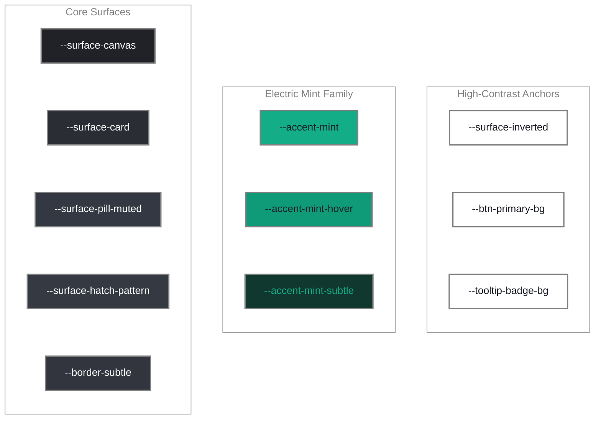
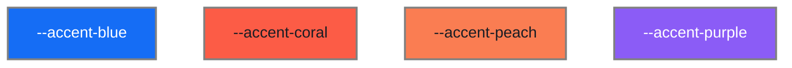
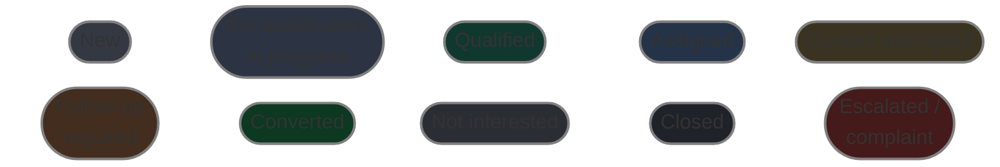
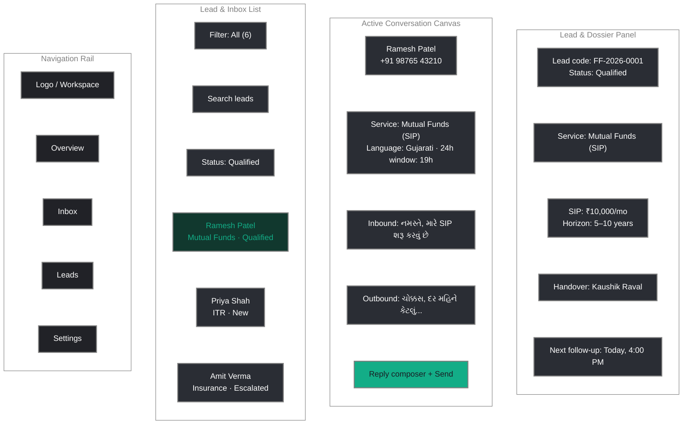

# UI/UX Design Guidelines — Futurefina Platform

> **Document Status**: Approved Design Standards  
> **Parent Navigation**: [Documentation Index](../README.md) | [PRD](PRD.md) | [Architecture](ARCHITECTURE.md) | [Decisions](DECISIONS.md)

---

## 1. Design Philosophy

The **Futurefina WhatsApp Bot & CRM** user interface is engineered for clarity, high information density, and low cognitive fatigue across extended advisor shifts. It embodies three core tenets:
1. **Respectful Conversational Flow**: Simple, polite, mobile-first WhatsApp interactions across **Gujarati, Hindi, and English**.
2. **Professional Financial Ergonomics**: Clean data presentation for the 6 service categories and 10 lead lifecycle stages without decorative clutter.
3. **High-Contrast Focus Anchors**: The approved **Obsidian-Mint** palette combines low-fatigue slate backgrounds with crisp white action pills and electric mint primary accents.

---

## 2. Color System & Design Tokens (Obsidian-Mint Palette)

In accordance with [DEC-006](DECISIONS.md#dec-006-adoption-of-obsidian-mint-ui-color-system-and-token-architecture), the platform enforces the following calibrated token system.

> [!NOTE]
> **Rendered color swatches:** The boards in §2.1 are Mermaid diagrams so the palette displays consistently in GitHub, VS Code, and other Mermaid-capable Markdown previews. Each swatch uses its exact production hex value. The **2px `#808080` frame is documentation-only** — it is a deliberately neutral gray outside the Obsidian-Mint library, it is not a product token, and it must never be used in UI components.

### 2.1 Visual Palette Boards

The swatch boards mirror the token tables in §2.2–§2.4 in the same order. Labels identify each token visually; the exact hex values remain in the adjacent tables for implementation and copy/paste.

#### 2.1.1 Core Surfaces & Brand Accents



> [!TIP]
> `--surface-hatch-pattern` is shown as a solid swatch for legibility. In the product it renders as a 45-degree diagonal hatch fill, not a flat color.

#### 2.1.2 Categorical & Data Visualization Accents



#### 2.1.3 Lead Status Pills (10 Official Statuses)



> [!IMPORTANT]
> Status is never communicated by color alone. Every status pill also carries its written label, and the table below preserves the background token, text color, and semantic role as accessible text.

### 2.2 Core Palette Tokens & Semantic Roles

| Semantic Token | Hex Value | Role & Interface Assignment |
| :--- | :--- | :--- |
| `--surface-canvas` | `#212227` | Deep dark slate app canvas, top bar background, and sidebar frame. |
| `--surface-card` | `#2A2D34` | Elevated card surfaces (Service Cards, Lead Detail Panels, Chat Canvas). Seamless rounded containers (`rounded-2xl`). |
| `--surface-pill-muted` | `#343842` | Muted secondary controls (e.g. "View" buttons, "Weekly ⌵" dropdown filter pills). |
| `--surface-hatch-pattern` | `#353942` | 45-degree diagonal striped fill for projected, scheduled, or inactive timeline/revenue bars. |
| `--border-subtle` | `#32353E` | Optical hairline borders, panel separators, table row dividers. |
| `--accent-mint` | `#13AD87` | **Primary Brand Accent**: Active navigation pill ("Overview"), positive metric pills ("+2.1%"), active chart bar ("$320"), gauge arc ("72%"), progress indicators, Help Center notification badge. |
| `--accent-mint-hover` | `#109B78` | Hover and active pressed states for mint interactive components. |
| `--accent-mint-subtle` | `#11382E` | Muted dark-mint background for subtle chip badges and active thread highlights. |
| `--surface-inverted` | `#FFFFFF` | **Inverted Spotlight Card**: Pure white card surface (e.g. bottom-left Customer Metric / VIP spotlight card) set against the dark canvas for intentional visual contrast. |
| `--btn-primary-bg` | `#FFFFFF` | **Primary Action Pill**: Pure white CTA buttons (e.g. "View chart ↗") with dark text (`#1A1D24`). |
| `--tooltip-badge-bg` | `#FFFFFF` | **Metric Tooltips**: Floating white pill badges for active chart values ("$320", "112K", "70%", "25%", "50%"). |

### 2.3 Categorical & Data Visualization Accents

Used for the 6 service categories, donut charts, and task scheduling:

| Accent Token | Hex Value | Interface Role |
| :--- | :--- | :--- |
| `--accent-blue` | `#156DF5` | Middle ring of Donut chart, Stocks & Demat indicators, active video call avatar border. |
| `--accent-coral` | `#FC5C46` | Inner ring of Donut chart, Insurance indicators, "Settings" notification badge, urgent escalations. |
| `--accent-peach` | `#FA7D52` | Loans & ITR indicators, stage 2 pipeline progress. |
| `--accent-purple` | `#8B5CF6` | Contact avatar ring badge (Devon Lane), Mutual Funds category badge. |

### 2.4 Lead Status Semantic Palette (10 Official Statuses)

| Lead Status | Background Token | Text Color | Visual Indicator Role |
| :--- | :--- | :--- | :--- |
| **New** | `#343842` | `#FFFFFF` | Muted slate pill; unprocessed inbound lead. |
| **Bot qualification in progress** | `#2C3342` | `#60A5FA` | Soft blue pill; customer actively conversing with bot. |
| **Qualified** | `#11382E` | `#13AD87` | Vibrant mint pill; all minimum fields captured. |
| **Assigned** | `#243348` | `#38BDF8` | Cyan pill; allocated to Kaushik Raval or team advisor. |
| **Contact attempted** | `#3B3322` | `#FBBF24` | Amber pill; advisor attempted phone call/message. |
| **Follow-up required** | `#422D1E` | `#FB923C` | Orange pill; customer requested scheduled callback. |
| **Converted** | `#0D3822` | `#34D399` | Emerald green pill; investment/policy/ITR finalized. |
| **Not interested** | `#2B2D34` | `#9CA3AF` | Neutral muted pill; lead declined service. |
| **Closed** | `#1F2228` | `#6B7280` | Dark gray pill; transaction complete or archived. |
| **Escalated / complaint** | `#451A1A` | `#F87171` | High-visibility crimson pill; urgent manager intervention. |

---

## 3. Multilingual Typography System

The interface supports **English, Gujarati (ગુજરાતી), and Hindi (हिंदी)** with balanced typographic rendering:

```css
/* Primary font stack for Latin and Indic scripts */
font-family-sans: "Inter", "Noto Sans Gujarati", "Shruti", "Noto Sans Devanagari", -apple-system, sans-serif;
font-family-mono: "JetBrains Mono", "SF Mono", Menlo, Consolas, monospace;
```

### Typographic Rules for Multilingual Financial UI:
1. **Line-Height Safety**: Indic scripts (Gujarati and Devanagari) require a minimum line-height of `1.6` (relative to font size) to prevent vowel signs (*matras*) and conjuncts from clipping.
2. **Font Weights**: Standard text uses `400 Regular` (English) / `500 Medium` (Gujarati/Hindi) for equivalent optical weight. Headings use `600 SemiBold`.
3. **Monospace for Numbers & Codes**: Phone numbers (`+91 98765 43210`), ARN codes (`ARN: 179325`), lead codes (`FF-2026-0001`), and ITR fees (`₹1,200`) must be styled in monospace.

---

## 4. Spacing, Sizing & Layout Grid

- **Base Increments**: 4px grid system (`4px`, `8px`, `12px`, `16px`, `24px`, `32px`, `48px`).
- **Touch Targets**: Minimum `44px x 44px` on mobile/touch interfaces; `36px` compact height for desktop data tables.
- **Card Geometry**: Large cards use `rounded-2xl` (16px); pills and badges use `rounded-full`.

---

## 5. Futurefina Workspace Layout Patterns

The core advisor console utilizes an adaptive **Tri-Pane Layout**:



> [!NOTE]
> The wireframe is rendered as a Mermaid diagram instead of an ASCII table so multilingual labels (Gujarati, Hindi, and English) and the four panes stay aligned at every preview width.

### Responsive Breakpoints:
- **Desktop (≥ 1280px)**: Full tri-pane view (Navigation + Lead Queue + Chat Canvas + Lead Dossier).
- **Tablet Landscape (1024px – 1279px)**: Dual-pane view; Lead Dossier collapses into a slide-over drawer.
- **Mobile (< 768px)**: Single-pane drilldown navigation (Inbox List -> Tap Lead -> Fullscreen Chat & Action View).

---

## 6. Component Standards & Ergonomics

### 6.1 WhatsApp Chat Bubbles
- **Inbound Message Bubble**:
  - Background: Muted Obsidian slate (`#343842`).
  - Text: Primary white (`#FFFFFF`) with `1.6` line-height for Gujarati/Hindi.
  - Alignment: Left-aligned with subtle rounded corner (`rounded-2xl rounded-tl-none`).
- **Outbound Message Bubble**:
  - Background: Deep mint tint (`#11382E`) with subtle mint edge border (`#13AD87`).
  - Text: Primary white (`#FFFFFF`).
  - Alignment: Right-aligned with subtle rounded corner (`rounded-2xl rounded-tr-none`).
  - Delivery Status Checkmarks: Single gray (`#8E92A0`), Double gray (`#8E92A0`), Double blue read tick (`#156DF5`).

### 6.2 Human Handover Alert Drawer
- Prominently displays structured handover payloads when triggered.
- Includes 1-click **"Claim Conversation"** button (in `#FFFFFF` white pill with `#1A1D24` text) and emergency escalation tags.

### 6.3 Indicative ITR Fee Admin Panel
- Provides clear input fields for admins to edit base prices (Salary: ₹1,200, Salary+Stocks: ₹1,500, High-volume: ₹2,000+) without requiring code changes.

---

## 7. Accessibility Standards (WCAG 2.2 AA)

1. **Color Contrast**: Minimum contrast ratio of `4.5:1` for standard text and `3:1` for large text/icons against `#212227` and `#2A2D34` surfaces.
2. **Keyboard Ergonomics**: Full arrow key (`Up`/`Down`) navigation through lead lists; `Enter` to open; `Esc` to close modal overlays.
3. **Screen Reader Support**: Incoming chat messages announced through polite ARIA live regions with explicit language tags (`lang="gu"`, `lang="hi"`, `lang="en"`).
