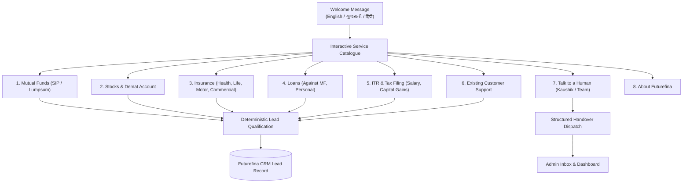

# Futurefina Consultancy — WhatsApp Bot & CRM
## Product Requirements Document (PRD)

> **Document Status**: Approved Baseline (Version 1.0)  
> **Business**: Futurefina Consultancy  
> **Founder / Business Owner**: Kaushik Raval  
> **Email**: futurefinadesk@gmail.com  
> **Website**: [https://www.futurefina.in](https://www.futurefina.in)  
> **AMFI Registration**: AMFI ARN: 179325  
> **Parent Navigation**: [Documentation Index](../README.md) | [Architecture](ARCHITECTURE.md) | [Design Guidelines](DESIGN_GUIDELINES.md) | [Security](SECURITY.md) | [Decisions](DECISIONS.md)

---

## 1. Product Overview & Vision

### 1.1 Executive Summary
Build an always-on WhatsApp assistant and CRM for **Futurefina Consultancy** that helps prospective and existing customers:
- Understand services and financial solutions.
- Receive answers to frequently asked questions.
- Submit structured service enquiries.
- Share required information and documents through approved, secure workflows.
- Seamlessly connect with a qualified human advisor (**Kaushik Raval** or designated advisory team members).

The bot functions as a **lead-generation, customer-service, and onboarding assistant**. It must never impersonate a human advisor, promise guaranteed returns, make unsupported product recommendations, or provide regulated advice beyond the firm's applicable registrations and permissions (AMFI ARN: 179325).

### 1.2 Product Vision
Make it effortless for a customer to start with a simple WhatsApp message and reach the right Futurefina service with transparent information, clear next steps, and a trusted human point of contact whenever needed.

### 1.3 Primary Goals
1. **Generate Qualified Leads**: Capture and qualify inbound customer demand across all 6 Futurefina service lines.
2. **Accelerate Response Times**: Automate repetitive initial queries and triage, reducing first-response latency to under 5 seconds.
3. **Structured Discovery & Onboarding**: Guide prospective customers through conversational service discovery and preliminary requirements gathering.
4. **Data Minimization**: Collect only the necessary information required for the selected financial service.
5. **Intelligent Human Handover & Routing**: Route qualified enquiries to the right person with comprehensive conversation context and track follow-ups.
6. **End-to-End Customer Experience**: Support customers across their entire lifecycle—before, during, and after a sale or service.

### 1.4 Non-Goals for MVP
- Executing trades, placing stock orders, or holding customer funds.
- Providing guaranteed returns or personalized stock buy/sell calls.
- Automatically issuing insurance policies or approving loans.
- Filing tax returns without explicit professional review, client authorization, and required statutory workflows.
- Replacing a licensed, qualified human professional where one is required by law or regulation.

---

## 2. Target Users, Segments & Core Jobs-to-be-Done

### 2.1 User Segments
- **New Prospects**: Customers exploring mutual funds, insurance, demat accounts, or tax filing for the first time.
- **Existing Clients**: Active mutual fund, demat, and insurance customers requiring ongoing portfolio assistance or service requests.
- **Support & Claim Seekers**: Clients seeking policy renewals, claim settlement guidance, or endorsement assistance.
- **Salaried Individuals & Investors**: Working professionals needing income tax return (ITR) preparation and capital gains filing.
- **Business Owners**: Small businesses and commercial vehicle owners seeking commercial insurance or workmen compensation.
- **Referrals & Campaign Audiences**: Inbound traffic referred by existing clients or targeted marketing campaigns.

### 2.2 Core Jobs to be Done
- *"Tell me which services Futurefina provides."*
- *"I want to start a SIP / invest a lumpsum."*
- *"I need health or term insurance."*
- *"I want to open a demat account."*
- *"I need help with ITR filing."*
- *"I need a policy renewal / claim-support callback."*
- *"I want to speak to Kaushik / a human advisor."*

---

## 3. Service Catalogue & Bot Journeys

The bot provides a clear, interactive main menu while permitting customers to type naturally at any point without being trapped in rigid menu trees.



---

### 3.1 Mutual Funds
- **Enquiry Types**: Start new SIP, make lumpsum investment, understand mutual funds and risk, portfolio service request, KYC/account opening assistance, pause/modify/stop SIP, goal-based investment discussion, loan against mutual funds (LAMF).
- **Information to Capture**:
  - Name and preferred language (Gujarati / Hindi / English).
  - New or existing customer.
  - SIP or lumpsum preference.
  - Indicative investment amount and frequency (monthly/quarterly).
  - Financial goal and approximate time horizon.
  - Self-described risk comfort (informational only; not a formal risk profile).
  - KYC status (Yes / No / Don't know).
  - Preferred callback time.
- **Bot Behaviour & Compliance**:
  - Explicitly disclose that mutual funds are market-linked and returns are not guaranteed.
  - Clarify that product suitability requires personalized discussion and formal risk profiling.
  - Share only approved educational material and official partner onboarding links.
  - Route transaction, portfolio-specific, and suitability questions to authorized human advisory workflows.
  - **Zero Credential Rule**: Never ask for OTP, UPI PIN, passwords, card numbers, or banking credentials.

---

### 3.2 Stocks & Demat Services
- **Enquiry Types**: Demat/trading account opening, general stock market education, existing demat support, IPO general enquiries, partner platform support.
- **Information to Capture**: Name, city, preferred language, new/existing account, broker/platform preference, nature of query, callback preference.
- **Bot Behaviour & Compliance**:
  - Explain account-opening steps using approved partner links only.
  - Strictly distinguish educational information from investment recommendations.
  - **Red Line**: Do NOT issue personalized buy/sell/hold calls, target prices, or model portfolios (AMFI ARN: 179325 does not authorize stock research or investment advisory).
  - Route broker-specific or trade-specific technical queries to the relevant broker's official support desk.

---

### 3.3 Insurance
Covers 7 distinct insurance product lines:
1. **Health Insurance**: Capture age band / DOB (only when needed), city / PIN code, number of family members to cover, relationship to proposer, desired cover amount, existing policy renewal status, pre-existing condition disclosure request (collected sensitively via secure workflow), callback preference.
2. **Term Life Insurance**: Capture age, city, approximate annual income band, smoking status (only when needed for quotation), cover amount, policy term, existing cover, callback preference. (Never promise acceptance or premium until underwriting approval).
3. **Traditional Life Insurance**: Capture purpose (protection / savings / endowment), budget, callback preference. Explain features using approved insurer material; never describe insurance as a guaranteed investment unless explicitly supported by policy wording.
4. **Motor Insurance (2-Wheeler, Private Car, Commercial Vehicle)**: Capture vehicle type, make/model, registration year, registration number (collected securely), existing insurer, expiry date, cover type (Third-Party / Comprehensive / Own-Damage). Provide secure document handoff for RC and previous policy copies.
5. **Commercial Insurance**: Support commercial vehicle, fire, shopkeeper, and business insurance enquiries. Capture business category, location, asset details, cover requirement, callback preference.
6. **Personal Accident Insurance**: Capture covered individuals, age band, occupation category, desired cover, callback preference.
7. **Workmen Compensation**: Capture business name, industry, employee count, work location, nature of work, desired start date. Route complex cases to a human specialist.
- **Insurance-Wide Rules**: Quotes are indicative until confirmed by the insurer. Policy issuance, exclusions, waiting periods, and claims are governed by insurer underwriting. Never guarantee claim approvals or conceal exclusions.

---

### 3.4 Loans
- **Products**: Loan against Mutual Funds (LAMF), Personal Loans.
- **Information to Capture**: Loan type, approximate amount required, employment / income category, eligible mutual fund holding value (avoiding account credentials), city, callback preference.
- **Bot Behaviour**: Explain that eligibility, interest rate, loan-to-value (LTV), and approval are determined solely by the partner lending institution. Never promise approval or disbursal timelines.

---

### 3.5 ITR and Tax Filing
- **Supported Enquiry Categories**:
  - Salary-only ITR.
  - Salary + Stocks / Capital Gains.
  - IPO gains and investments.
  - High-volume trading / complex F&O transaction cases.
  - Other income or complex return enquiries.
- **Information to Capture**: Assessment Year / Financial Year, income type, availability of Form 16 / AIS / 26AS / broker capital gains statements, approximate complexity, preferred callback time.
- **Indicative Fee Reference (Admin-Editable)**:
  - **Salary-only**: `₹1,200`
  - **Salary + Stocks / IPOs**: `₹1,500`
  - **High-volume trading / Complex cases**: `₹2,000+` (subject to review).
  *(Indicative prices only; admin can update these without code changes).*
- **Bot Behaviour**: Share checklists of required tax documents. Explain that final scope and fees require professional document review. Never promise refunds or file returns without explicit customer review and authorization.

---

### 3.6 Existing Customer Support
- **Request Types**: SIP service requests, insurance renewal reminders/assistance, policy document/receipt requests, claim support, demat support routing, ITR status check, service escalations, callback requests.
- Collect reference numbers and service categories securely; never request sensitive identity or banking documents in an ordinary unencrypted chat.

---

## 4. Conversation Design & Multilingual Architecture

### 4.1 Welcome Message Copy
The bot initiates conversations with warm, respectful, multilingual greeting copy:

> *"નમસ્તે! Welcome to Futurefina Consultancy 👋  
> I'm Futurefina's virtual assistant. I can help you with:  
> • Mutual Funds — SIP & Lumpsum  
> • Stocks & Demat Account  
> • Health, Life & General Insurance  
> • Loans  
> • ITR & Tax Filing  
> • Existing Customer Support  
> 
> Choose a service or simply type what you need.  
> **ગુજરાતી | हिंदी | English**  
> 
> For personalized guidance, I can connect you with our team."*

### 4.2 Conversation Principles
1. **Mobile-First Readability**: Keep messages concise, well-spaced, and easily scannable on mobile screens.
2. **One Question at a Time**: Avoid overwhelming the user with long multi-part questions.
3. **Explain Sensitive Requests**: Always state *why* a piece of information is requested (e.g. *"To provide an accurate health insurance quote, may I know your age band?"*).
4. **Skippable Questions**: Allow users to skip optional fields.
5. **Confirmation Step**: Display a clear summary of captured details for user confirmation before generating a lead record.
6. **No Repetition**: Never ask a user for information already provided earlier in the conversation.
7. **Safe Handover Trigger**: Offer human handover whenever uncertainty is detected rather than hallucinating an answer.
8. **Universal Commands**: Support `"Menu"`, `"Back"`, `"Talk to human"`, and natural language queries at all stages.

---

## 5. Lead Capture & CRM Architecture

### 5.1 Minimum Lead Record Specification
Every captured lead stored in Futurefina CRM contains:
- `lead_id`: Permanent unique identifier (e.g. `FF-2026-0001`).
- `whatsapp_number`: Normalized E.164 phone number.
- `customer_name`: Provided name.
- `preferred_language`: `Gujarati` | `Hindi` | `English`.
- `service_category`: `Mutual Funds` | `Stocks/Demat` | `Insurance` | `Loans` | `ITR` | `Support`.
- `service_subcategory`: Specific flow (e.g. `SIP`, `Health Insurance`, `Salary ITR`).
- `customer_type`: `New` | `Existing`.
- `enquiry_summary`: Contextual summary of customer requirements.
- `consent_timestamp`: Explicit record of conversational consent.
- `promotional_opt_in`: Distinct boolean flag for marketing consent.
- `lead_status`: Current lifecycle state (one of 10 official statuses).
- `assigned_owner`: Futurefina team member (default: Kaushik Raval).
- `next_follow_up_date`: Scheduled follow-up timestamp.
- `internal_notes`: Team collaboration and progress notes.
- `created_at` / `updated_at`: Audit timestamps.

### 5.2 The 10 Official Lead Statuses
```text
[New] 
  └── [Bot qualification in progress] 
        └── [Qualified] 
              └── [Assigned] 
                    ├── [Contact attempted] 
                    │     └── [Follow-up required] 
                    │           ├── [Converted] 
                    │           └── [Not interested] 
                    ├── [Closed] 
                    └── [Escalated / complaint]
```

### 5.3 Lead Routing & Prioritization
- **Category Routing**: Automatically assign leads to designated category specialists.
- **High-Intent Priority**: Prioritize high-intent leads (e.g., immediate SIP investments, urgent insurance quotation, immediate ITR filing).
- **Urgent Escalations**: Immediately escalate claims, complaints, policy lapses, and transaction-blocking issues to Kaushik Raval.

### 5.4 Admin Dashboard Requirements
- Search leads by customer name, phone number, service line, status, and date.
- Multi-dimensional filters (by service line and lead owner).
- Complete conversation transcript summary and consent audit record.
- Lead reassignment and status transition controls.
- Internal note-taking and next follow-up scheduler.
- Role-based export functionality (CSV/Excel).
- Executive KPI counter cards: Total New Leads, Qualified Leads, Pending Follow-ups, Conversions.
- Zero-code configuration panel to update FAQs, indicative pricing, partner links, and operating hours.

---

## 6. Human Handover Protocol

Human assistance is accessible at any point during customer interactions.

### 6.1 Handover Triggers
- Explicit user request (*"Talk to human"*, *"Connect to Kaushik"*, *"Call me"*).
- Bot confidence score drops below threshold or customer repeats the same enquiry.
- High-sensitivity domains: Claims, complaints, policy rejections, tax notices.
- Complex personalized suitability or portfolio discussions.
- Customer requests an in-person or telephone appointment.

### 6.2 Structured Handover Payload
When a handover occurs, the system pushes a structured briefing to the advisor inbox:
```json
{
  "customer_name": "Ramesh Patel",
  "phone": "+919876543210",
  "preferred_language": "Gujarati",
  "service_category": "Mutual Funds",
  "subcategory": "Start New SIP",
  "captured_answers": {
    "indicative_amount": "₹10,000/month",
    "horizon": "5-10 years",
    "risk_comfort": "Moderate",
    "kyc_status": "Completed"
  },
  "conversation_summary": "Customer looking to start long-term wealth creation SIP. Wants clarification on tax-saving ELSS vs regular flexi-cap funds.",
  "urgency": "High",
  "reason_for_handover": "Personalized fund suitability discussion",
  "consent_status": "Verified",
  "preferred_callback_time": "Today, 4:00 PM - 6:00 PM"
}
```

---

## 7. Knowledge Base & Grounded Q&A

The bot operates strictly against an approved, version-controlled knowledge base:
- Futurefina profile, business address, and contact details.
- AMFI ARN 179325 disclosures and regulatory scope.
- Mutual fund basics, terminology, and statutory risk disclosures.
- Insurer-approved product brochures and comparison sheets.
- Demat account opening guides and partner platform links.
- Loan application procedures and lender criteria.
- ITR document checklists (Form 16, 26AS, AIS, capital gains reports).
- Office hours, callback policies, and complaint escalation procedures.

**Safety Rule**: Every Q&A item must have a designated owner, verification source, and last-reviewed date. If an approved answer does not exist, the bot must safely fall back and connect the customer to a human advisor.

---

## 8. Functional Requirements & Phasing Matrix

| ID | Requirement Description | Priority |
| :--- | :--- | :--- |
| **FR-01** | Multilingual welcome message and language selector (Gujarati, Hindi, English) | **P0 (MVP)** |
| **FR-02** | Interactive main menu covering all 6 service lines | **P0 (MVP)** |
| **FR-03** | Natural-language intent detection and grounded FAQ answering | **P0 (MVP)** |
| **FR-04** | Service-specific deterministic lead qualification flows | **P0 (MVP)** |
| **FR-05** | Granular consent capture and instant opt-out processing | **P0 (MVP)** |
| **FR-06** | Human handover with structured context payload | **P0 (MVP)** |
| **FR-07** | Admin lead inbox with 10 statuses, assignment, and search | **P0 (MVP)** |
| **FR-08** | Version-controlled knowledge base with fallback safeguards | **P0 (MVP)** |
| **FR-09** | Secure document upload handoff (preventing raw chat doc exposure) | **P1 (Next)** |
| **FR-10** | Automated follow-up task scheduler and agent reminders | **P1 (Next)** |
| **FR-11** | Policy renewal and ITR-season opt-in broadcast reminders | **P1 (Next)** |
| **FR-12** | Integrated calendar appointment scheduling | **P1 (Next)** |
| **FR-13** | Detailed conversion reporting and SLA response metrics | **P1 (Next)** |
| **FR-14** | Third-party CRM and partner API synchronization | **P2 (Later)** |
| **FR-15** | Advanced multilingual voice note transcription and personalization | **P2 (Later)** |

---

## 9. Non-Functional Requirements & Performance SLAs

- **Availability Target**: 99.5% monthly availability for backend services.
- **Automated Response Latency**: Sub-5 seconds at the 95th percentile for all bot interactions.
- **Data Isolation**: Strict multi-session isolation guaranteeing zero cross-customer data leakage.
- **Audit Logging**: Comprehensive, immutable logging of all consent events, handovers, status changes, and data exports.
- **Mobile-First Admin UI**: Fully responsive admin dashboard engineered around the **Obsidian-Mint** design system.

---

## 10. Acceptance Criteria (MVP Launch Gate)

1. [ ] A customer can choose **Gujarati, Hindi, or English** and seamlessly navigate all 6 service categories or request human assistance.
2. [ ] Each service qualification flow collects the defined minimum data attributes while allowing optional questions to be skipped.
3. [ ] Details and conversational consent are explicitly confirmed with the user prior to lead record creation.
4. [ ] Leads are assigned a unique permanent ID, deduplicated, and visible in real time on the Admin Dashboard.
5. [ ] Human handover delivers an accurate structured briefing payload to the advisor console.
6. [ ] Unsupported or ambiguous queries trigger graceful fallback without hallucination.
7. [ ] Under no circumstances does the bot ask for prohibited credentials (OTPs, PINs, banking passwords) or make guaranteed return claims.
8. [ ] Admins can modify FAQs, service links, ITR prices, and office hours without code redeployment.
