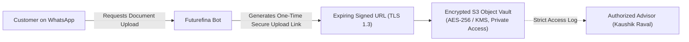

# Security, Compliance & Data Privacy Standards

> **Document Status**: Mandatory Engineering Policy  
> **Parent Navigation**: [Documentation Index](../README.md) | [PRD](PRD.md) | [Architecture](ARCHITECTURE.md) | [Decisions](DECISIONS.md)

---

## 1. Zero-Tolerance Financial Data Policy

> [!CAUTION]
> **STRICT FINANCIAL SERVICES COMPLIANCE BLOCKER**  
> Under no circumstances may the Futurefina bot, backend application, or CRM database ever request, capture, log, or store sensitive financial authentication credentials.

### Prohibited Credentials (Strict Red Lines):
1. **One-Time Passwords (OTPs)**: Never ask for or accept OTPs for any bank, broker, or mutual fund transaction.
2. **Personal Identification Numbers (PINs)**: Never request UPI PINs, ATM PINs, or card PINs.
3. **Banking & Broker Credentials**: Never request net-banking usernames, passwords, trading passwords, or 2FA credentials.
4. **Card Details**: Never request card numbers, expiry dates, or CVV/CVC codes.

If a customer inadvertently inputs any credential into a chat, the system's regex filter must automatically redact the sensitive string before logging or database persistence, and issue an immediate automated safety warning.

---

## 2. Regulatory Boundaries & Disclaimers (AMFI ARN: 179325)

Futurefina Consultancy operates under **AMFI ARN: 179325** as a registered Mutual Fund Distributor:

1. **Statutory Investment Disclaimers**:
   - Every mutual fund flow must convey that *mutual fund investments are subject to market risks, and returns are not guaranteed*.
   - Product suitability requires personalized discussion and risk profiling by a qualified advisor.
2. **Registration Boundary Disclosures**:
   - The platform must never state or imply that AMFI ARN: 179325 authorizes stock research, personalized buy/sell/hold calls, model portfolios, or portfolio management services (PMS).
   - Stock and demat services are limited strictly to account-opening assistance via approved partner links and general financial education.
3. **Insurance Solicitation Rules**:
   - Insurance quotes are indicative until finalized by insurer underwriting. Exclusions, waiting periods, and policy wordings must never be concealed.

---

## 3. Secure Document Handoff Protocols (PRD Section 9)

In ordinary chat interactions, customers often attempt to send sensitive identity and financial documents (PAN cards, Aadhaar cards, Form 16, AIS, 26AS, bank statements).

### Security Architecture for Documents:


1. **No Raw Unencrypted Chat Storage**: Avoid requesting identity or tax documents in raw WhatsApp chat. Generate a secure, expiring one-time link for document upload.
2. **Encryption at Rest & in Transit**: All uploaded tax and financial documents are encrypted at rest using AES-256 (KMS-managed keys) and transmitted strictly over TLS 1.3.
3. **Restricted Access Controls**: Only authorized advisors with designated role-based permissions may decrypt and review customer financial documents.

---

## 4. Consent Architecture & Opt-Out Processing

Futurefina strictly separates conversational consent into two distinct, auditable categories:

```text
[Customer Interaction]
  ├── [1. Enquiry Response Consent] ──── Granted implicitly by initiating query;
  │                                     valid strictly for resolving the enquiry.
  └── [2. Promotional / Broadcast Consent] ─ Explicit separate opt-in required;
                                        governs seasonal ITR & SIP market updates.
```

1. **Enquiry vs. Promotional Consent**: Separate database tracking (`consent_type`). Never send promotional broadcasts to customers who only consented to a specific service enquiry.
2. **Instant Opt-Out Honoring**:
   - Incoming keywords (`STOP`, `UNSUBSCRIBE`, `CANCEL`, `બંધ કરો`) immediately set `promotional_opt_in = false` and halt all scheduled reminders.
   - The CRM interface visually restricts advisors from initiating outbound template broadcasts to opted-out contacts.
3. **Audit Trail**: Every consent grant and revocation is immutably logged with timestamp, phone number, and consent wording version.

---

## 5. Meta Webhook HMAC Verification

All inbound HTTP POST requests to `/api/webhooks/whatsapp` must undergo constant-time HMAC-SHA256 verification against `WHATSAPP_APP_SECRET`:

```typescript
import crypto from "crypto";

export function verifyMetaSignature(
  rawBody: Buffer,
  signatureHeader: string | undefined,
  appSecret: string
): boolean {
  if (!signatureHeader) return false;
  
  const [algorithm, signature] = signatureHeader.split("=");
  if (algorithm !== "sha256" || !signature) return false;
  
  const expectedHash = crypto
    .createHmac("sha256", appSecret)
    .update(rawBody)
    .digest("hex");
    
  return crypto.timingSafeEqual(
    Buffer.from(signature, "hex"),
    Buffer.from(expectedHash, "hex")
  );
}
```

---

## 6. Prompt Injection Defense & AI Safety Guardrails

Because the system accepts free-form text from external WhatsApp users:
1. **Strict Context Isolation**: Customer input is treated as untrusted user data. It is never interpolated directly into system instructions.
2. **Grounded Retrieval**: The LLM intent classifier is bounded strictly to the verified Futurefina knowledge base. It is technically barred from executing arbitrary tools or accessing unauthorized databases.
3. **No Training on Customer Data**: Customer conversations and uploaded financial documents are strictly barred from being used to train public AI models.

---

## 7. Incident Response & Vulnerability Reporting

If a security anomaly or potential data exposure is identified:
1. Contact: `futurefinadesk@gmail.com` (cc: Kaushik Raval).
2. Triage SLA: 24-hour initial acknowledgment; 72-hour remediation window for high-severity findings.
